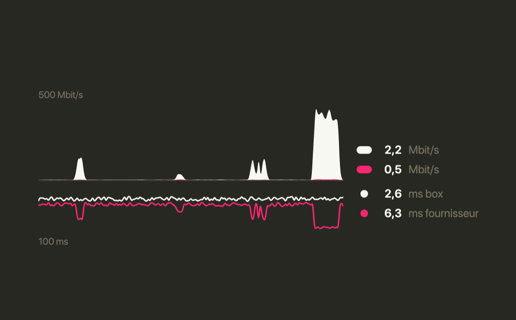
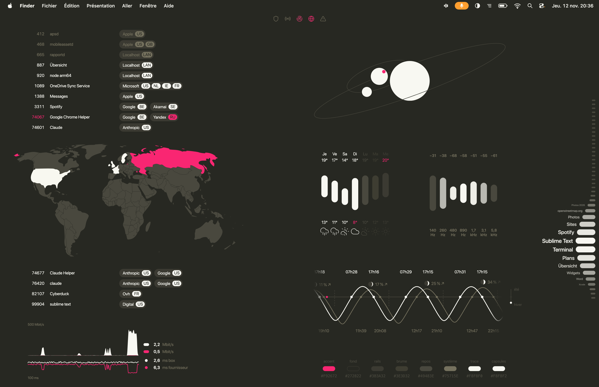

# Capsules – Débits

Les débits de ce Mac sur les 30 dernières minutes : le téléchargement en blanc, l'envoi en rose par-dessus, à la même échelle.
En dessous, la latence vers votre box et vers le premier routeur de votre fournisseur.

Un widget pour [Übersicht](https://tracesof.net/uebersicht/), gratuit, pour macOS.

Il fait partie de **Capsules**, mon bureau : une composition de widgets et d'applications en capsules, sur fond anthracite.
Tout le bureau, l'animation et les autres widgets : **[fafag.fr › Capsules › Débits](https://fafag.fr/?capsules/debits)**

## Installation

1. Installer [Übersicht](https://tracesof.net/uebersicht/).
2. Télécharger `capsules-debits.widget.zip` et le décompresser.
3. Placer le dossier `capsules-debits.widget` dans le dossier des widgets (Übersicht → Open Widgets Folder).

Le widget s'affiche en haut à gauche de l'écran. Il tient en un seul fichier JavaScript : aucun script ni aucune commande à installer à côté.

## Comment ça marche

- `netstat` toutes les 2 secondes pour les débits, `ping` toutes les 10 secondes pour la latence.
- `traceroute` une fois par réseau (puis toutes les heures) pour trouver le premier routeur du fournisseur.
- Tout est déjà présent sur macOS, sans clé ni compte. L'historique est gardé en mémoire et survit au redémarrage d'Übersicht.
- Pourquoi le rose ? Il signale ce qui sort du Mac : un envoi inattendu se voit tout de suite.

## Réglages

Tout se règle en haut de `bandwidth.jsx`, dans `MES_REGLAGES`. Les valeurs complètes sont juste en dessous, dans `DEFAUTS` ; une clé absente ou mal écrite garde sa valeur par défaut.

- La position et la largeur : `general: { top: 20, left: 20, largeur: 320 }` (en points depuis le coin haut gauche).
- Les échelles, au-dessus et au-dessous de l'axe : linéaire ou logarithmique, automatique ou fixe.
- Le lissage et les couleurs.
- `latence: { afficher: false }` coupe les pings.

Police : SF Pro Rounded si elle est installée, sinon la police arrondie du système.

---

**In English** – A widget for Übersicht: this Mac's download (white) and upload (pink, on top, same scale) over the last 30 minutes, and below, the latency to your router and to your provider's first hop. Uses `netstat`, `ping` and `traceroute`, all built into macOS. Settings are at the top of `bandwidth.jsx` (comments in French). More on [fafag.fr](https://fafag.fr/?capsules/debits).

Licence MIT – Fafa, [fafag.fr](https://fafag.fr)
